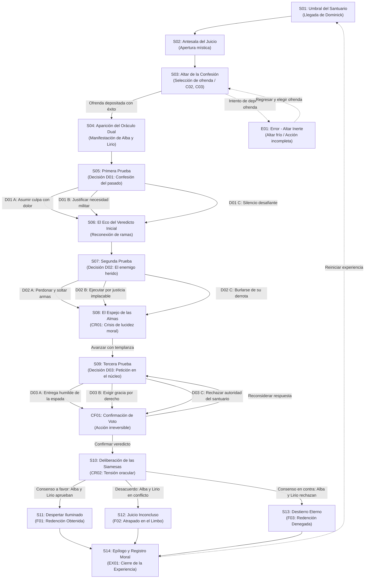

# Diseño de una novela visual

## Plantilla de informe técnico del proyecto de curso

Este documento registra cómo el equipo define, construye, prueba y mejora una micronovela visual navegable.  
Su propósito es justificar las decisiones de contenido y conservar evidencia de la evolución del prototipo.

### Nombre del juego

Unspoken Words

### Autores y curso

- Juan José Bolaños Delgado
- Daniel Arias Castrillón
- Alejandra Ospina

### Datos de esta entrega

Entregable 1: Definición narrativa, arquitectura de interacción y especificación del prototipo (Octubre 2026 - Versión 3.0)

### Acceso al prototipo

[Prototipo navegable en Figma: Visual Novel Wireframes](https://www.figma.com/make/Bd0zqu6iXAapBSyfUHNjQb/Visual-Novel-Wireframes?t=TjqwrRV7toH5ttIH-1) (Versión 1.0 - Punto de inicio: Pantalla S01 - Umbral del Santuario)

---

### Cómo completar la plantilla

Reemplacen los textos entre corchetes por información del proyecto. Dupliquen las fichas y filas necesarias. Identifiquen capturas y anexos mediante códigos y expliquen qué evidencia aporta cada uno. Las orientaciones pueden retirarse de la versión final.

Mantengan un único informe acumulativo. En la primera entrega, marquen las secciones de pruebas e iteración como pendientes. En las siguientes, actualicen la síntesis y registren los cambios. No presenten supuestos como resultados ni inventen pruebas, participantes o fuentes.

---

## 1 Síntesis y delimitación del proyecto

_Completar en la entrega 1 y actualizar en las entregas 2 y 3_

### Resumen técnico

Esta micronovela visual aborda la dificultad de representar dilemas morales interactivos donde las decisiones del jugador impactan genuinamente en el desarrollo ético y psicológico del protagonista, superando las ramificaciones cosméticas tradicionales. Diseñada para un público joven adulto y universitario (18 a 30 años) con interés en ficciones interactivas y narrativa de fantasía oscura, la obra sitúa al usuario en el rol de Dominick, un caballero cuyas determinaciones frente a situaciones límite van moldeando progresivamente los rasgos de su personalidad (honor, pragmatismo o desapego). El propósito es propiciar una experiencia inmersiva y reflexiva, pero a la vez intensa donde cada elección desencadene consecuencias éticas tangibles, llevando el relato a tres posibles desenlaces contrastantes a través de distintos escenarios. La solución se materializa en un prototipo interactivo navegable desarrollado en Figma, que incorpora microcopy contextual, decisiones de bifurcación con memoria narrativa y estados de validación funcional.

### Problema y propósito

**Problema:** En el diseño de narrativas interactivas, las decisiones morales suelen reducirse a elecciones binarias superficiales ("bueno" vs. "malo") que generan disonancia ludo-narrativa, provocando que el usuario no sienta el peso real de sus acciones ni perciba cómo forjan el carácter del personaje.

**Propósito:** Brindar una experiencia donde el jugador deba navegar dilemas éticos sin respuestas fáciles, comprendiendo que cada línea de diálogo y acción asumida moldea internamente la brújula moral de Dominick y determina directamente su destino.

**Criterio observable de éxito:**
1. Al menos el 80% de los evaluadores identifica con claridad en cuál de las facetas éticas concluyó Dominick tras su partida.
2. El usuario reconoce la relación causal directa entre sus elecciones de diálogo y el desenlace obtenido (`F01`, `F02` o `F03`).
3. El recorrido completo de 8 a 12 minutos se efectúa sin abandonos ni bloqueos por ambigüedad en las etiquetas de decisión.

### Alcance del curso

Experiencia de 8 a 12 minutos; máximo tres personajes principales; tres decisiones significativas con dos o tres opciones cada una; dos o tres desenlaces; 12 a 18 pantallas o pasajes principales (14 pantallas principales en este proyecto: `S01` a `S14`). Documenten las variantes de estado aparte y reconecten ramas cuando sea pertinente.

Incluyan un formulario breve o interacción equivalente, error y recuperación, confirmación, éxito o cierre, dos estados críticos y una decisión explícita de accesibilidad. El resultado es un prototipo navegable por enlace; la programación y la alta fidelidad visual no son obligatorias.

| Versión y fecha | Cambio relevante | Autoría |
| :--- | :--- | :--- |
| v1 (13/10/2026) | Creación y primera estructuración del informe técnico | Juan José Bolaños y Daniel Arias |
| v2 (15/10/2026) | Modificación y ampliación de escenarios narrativos | Juan José Bolaños |
| v3 (15/10/2026) | Adecuación técnica al género de novela visual: eliminación de entradas de texto libre, integración del selector de ofrendas rituales (interacción equivalente), compleción de fichas de estado (E01, CR02), especificación técnica de prototipo y declaración de IA | Daniel Arias, Juan José Bolaños y Alejandra Ospina |

---

## 2 Público contexto y referentes

_Entrega 1_

### Público y contexto de uso

- **Perfil del público:** Jóvenes adultos y estudiantes universitarios (18 a 30 años) con interés en géneros de fantasía oscura, rol (RPG) y novelas visuales narrativas.
- **Experiencia previa:** Leve familiaridad con mecánicas de diálogo de elección múltiple y lectura interactiva en pantalla.
- **Necesidades de lectura:** Requieren textos fragmentados y concisos (máximo 3 a 4 líneas por bloque narrativo), microcopy funcional que evidencie la intención de la respuesta antes de pulsar y ritmo pausado con control manual de avance.
- **Dispositivo y entorno:** Acceso mediante enlace de Figma en navegadores de escritorio (resolución 1920×1080 o laptops). El uso se sitúa en sesiones cortas y concentradas de 8 a 12 minutos en entornos cotidianos (hogar o estudio).
- **Sustento y supuestos:**
  - `[Evidencia]`: Hábitos consolidados de consumo de medios interactivos y narrativas ramificadas en el rango del curso.
  - `[Supuesto]`: Preferencia por opciones de diálogo con intención explícita frente a las elecciones del jugador; disposición a rejugar para explorar los 3 desenlaces (pendiente de validación empírica en la Entrega 2).

### Necesidades y riesgos comunicativos

- **Información requerida antes de actuar:**
  - El usuario debe conocer el contexto del dilema ético inmediato, las partes en conflicto y las consecuencias potenciales que están en juego antes de que se le exija decidir.
  - Las opciones de diálogo deben comunicar con claridad la intención y carga emocional de Dominick (si responde con templanza, agresión o evasión) para evitar desajustes entre la intención del jugador y la reacción del personaje.
  - Se debe informar cuándo una acción es crítica o irreversible mediante avisos previos o pantallas de confirmación (`CF01`).

- **Confusiones, barreras y riesgos de exclusión a prevenir:**
  - *Disonancia de intención (falsa expectativa dialógica):* Prevenir que una etiqueta resumida haga decir a Dominick algo inesperado para el jugador. **Ajuste:** Diseñar etiquetas con verbos de acción e intención explícita (ej. "Cuestionar con frialdad" en lugar de un ambiguo "Hablar").
  - *Barreras visuales y contraste:* Evitar tipografías demasiado ornamentales e ilegibles o bajo contraste sobre fondos oscuros. **Ajuste:** Cumplimiento de ratio de contraste WCAG AA (mínimo 4.5:1) y tipografía sans-serif legible en botones y diálogos.

![[Pasted image 20261015155647.png]]
*Niveles de contraste WCAG en texto regular. Fuente: Stark plugin / Accessible contrast ratios and A-levels explained.*

### Análisis de referentes

Seleccionen obras o interfaces pertinentes. Comparen decisiones de narrativa y contenido; no se limiten a describir su apariencia. Incluyan la fuente y la fecha de consulta.

| Referente y fuente | Qué se analiza | Aplicación al proyecto |
| :--- | :--- | :--- |
| [Arte de alew.scrawl](https://www.instagram.com/alew.scrawl/) (Alejandra Ospina, Octubre 2026) | Estilo visual/artístico para los personajes y la atmósfera del santuario; diseño expresivo de figuras e indumentaria. | Uso de diseños originales de personajes con participación directa y permiso de la artista como coautora del equipo. |
| *De lo espiritual en el arte* - Vasili Kandinski (1911) | Teoría del color y su resonancia psicológica y espiritual. Relación con las 4 antinomias del color y el dinamismo hacia o lejos del espectador. | Base conceptual para caracterizar visual y cromáticamente a Alba (amarillo / calidez / cercanía / pureza) y Lirio (violeta / introversión / distancia / juicio severo). |

### Conclusión del análisis

Los personajes que usaremos tienen una naturaleza medieval, mística y algo oscura, de igual la manera en que Alejandra los trata, alude mucho a la introspección, y también a experiencias mundanas, que a pesar de ser tan normales en nuestro día a día son importantes y juegan un papel intrínseco en nuestras vidas. El objetivo es plasmar un poco eso ahí, la introspección en la naturaleza noble del caballero, y la introversión y extraversión de los personajes. Este último aspecto se estudia bastante en el color, y también como el color puede acercarse al espectador o alejarse de él, no solo al nivel de la personalidad de los personajes, sino también de lo que se quiere comunicar con los diálogos, la interfaz, y las opciones de selección a lo largo de la experiencia del usuario.

### Criterios para evaluar la experiencia

Para evaluar la interacción y la recepción narrativa del prototipo durante las pruebas con usuarios (programadas para la Entrega 2), se establecen cuatro criterios con indicadores observables y métodos de verificación concretos:

1. **Anticipación de la acción e intención dialógica:**
   - *Indicador observable:* La persona comprende la actitud y carga moral que adoptará Dominick antes de presionar un botón de opción en el diálogo.
   - *Método de comprobación:* Protocolo de pensamiento en voz alta (*Think Aloud*) en las tres decisiones clave (`D01`, `D02`, `D03`); meta: al menos el 80% de los participantes anticipa correctamente la postura que asumirá el personaje.

2. **Diferenciación y peso de las opciones morales:**
   - *Indicador observable:* La persona distingue con claridad el contraste ético entre las alternativas de cada decisión, sin percibir que conducen al mismo resultado por mero artificio estético.
   - *Método de comprobación:* Pregunta cualitativa post-decisión ("¿Sentiste que las opciones representaban caminos morales distintos?"); umbral esperado: calificación promedio ≥ 4/5.

3. **Recuperación autónoma del estado de error (`E01`):**
   - *Indicador observable:* Al interactuar con el altar de ofrenda sin haber marcado previamente una reliquia simbólica, el usuario comprende la causa del bloqueo y localiza de inmediato la salida navegable sin abandonar la experiencia ni reiniciar el prototipo.
   - *Método de comprobación:* Observación de navegación sin intervención del equipo; meta: 100% de los usuarios retorna exitosamente a la pantalla de selección en menos de 10 segundos.

4. **Completitud de ruta y atribución causal del desenlace:**
   - *Indicador observable:* La persona completa una sesión de lectura de 8 a 12 minutos hasta uno de los tres desenlaces (`F01`, `F02` o `F03`) y atribuye el destino final de Dominick a las decisiones tomadas a lo largo de los diálogos.
   - *Método de comprobación:* Cuestionario de cierre con la pregunta: "¿El final obtenido se sintió consecuente con la personalidad que construiste para Dominick?"; meta esperada: ≥ 80% de respuestas afirmativas fundamentadas en elecciones previas.

---

## 3 Arquitectura narrativa y reglas de interacción

_Entrega 1_

### Premisa y dilema central

Dominick cometió un acto atroz en la guerra, algo de lo que se siente muy arrepentido, porque no se siente orgulloso de ello para nada y busca expiación. Viaja al santuario prohibido de Alba y Lirio, ellas actúan como juezas del oraculo (Alba juzga la intención/emoción; Lirio juzga el hecho/consecuencia).

| Personaje | Función narrativa | Motivación y relación |
| :--- | :--- | :--- |
| Dominick | Protagonista | Aún se está por definir con exactitud. Sin embargo por ahora la motivación es la redención y su propia paz, buscará esto a través de una aventura que puede llegar a ser peligrosa. |
| Alba | Reto a superar / jueza moral (emocional) | Definir el destino de Dominick de acuerdo a lo que él siente en las decisiones que toma a lo largo de los retos. |
| Lirio | Reto a superar / jueza moral (pragmático) | Definir el destino a partir no de su ejercicio mental y moral para decidir la resolución del reto en cuestión, sino del resultado de este. |

### Mapa narrativo

**Descripción textual equivalente del mapa narrativo:**
1. **Punto de inicio (`S01`):** Dominick arriba al umbral del santuario y avanza a la antesala mística (`S02`).
2. **Interacción ritual de entrada (`S03`):** Dominick debe seleccionar una ofrenda simbólica en el altar. Si pulsa depositar sin selección previa, se activa el error `E01`, retornando a `S03`. Con la ofrenda elegida, transiciona a `S04` donde se manifiestan Alba y Lirio.
3. **Primera decisión (`D01` en `S05`):** Frente a la confesión de la aldea arrasada, el jugador escoge entre admitir culpa (`D01 A`), justificar necesidad militar (`D01 B`) o desafiar con frialdad (`D01 C`). Todas las ramas reconectan en el pasaje de transición `S06`.
4. **Segunda decisión (`D02` en `S07`):** Frente al general enemigo herido, el jugador decide perdonar (`D02 A`), ejecutarlo conforme a ley marcial (`D02 B`) o humillarlo con crueldad (`D02 C`). Conduce al estado crítico `CR01` en `S08` (El Espejo de las Almas).
5. **Tercera decisión y confirmación (`D03` en `S09` y `CF01`):** En el Núcleo, Dominick entrega su espada con humildad (`D03 A`), exige absolución por servicio (`D03 B`) o rompe el rito con desprecio (`D03 C`). La acción abre el modal de confirmación irreversible `CF01`, permitiendo ratificar la consagración o volver a `S09` a reconsiderar.
6. **Deliberación clímax (`CR02` en `S10`):** El oráculo dual evalúa el balance de afinidades éticas acumuladas.
7. **Desenlaces (`S11`, `S12`, `S13`):** Se bifurca hacia la redención luminosa (`F01`), el limbo inconcluso por desacuerdo (`F02`) o el destierro sombrío (`F03`).
8. **Cierre (`S14` / `EX01`):** Todas las ramas convergen en el epílogo y balance moral, ofreciendo la opción de reiniciar la travesía hacia `S01`.

### Reglas y memoria de las decisiones

- **Variables conservadas en memoria:**
  - `Afinidad_Alba` (entero): Mide la validación moral emocional (arrepentimiento, empatía, renuncia al ego).
  - `Afinidad_Lirio` (entero): Mide la validación moral pragmática (coherencia de hechos, asunción de responsabilidad, templanza y justicia objetiva).
  - `Rasgo_Dominick` (texto): Registra el perfil ético predominante del protagonista (*Caballero Íntegro*, *Pragmático Marcial* o *Tiránico Impenitente*).
- **Cómo condiciona escenas y finales:**
  - En `S06`, el diálogo de las siamesas varía sutilmente según la opción elegida en `D01`.
  - En `S10` (`CR02`), se evalúa el balance combinado de ambas variables para determinar el veredicto unánime a favor (`F01`), el conflicto entre ellas (`F02`), o la condena unánime (`F03`).
  - *Simulación en la herramienta:* En Figma, esta lógica se simula mediante conexiones de flujo ramificado que enlazan las combinaciones éticas representativas a los tres desenlaces correspondientes.

### Ficha de decisión repetible

#### Decisión D01: La Confesión del Pasado (Pantalla S05)
*Frente al estanque del santuario, Alba y Lirio interrogan a Dominick sobre la aldea destruida bajo su mando durante la guerra.*

| Opción y texto visible | Consecuencia narrativa | Estado y destino |
| :--- | :--- | :--- |
| **D01 A:** Reconocer la culpa con pesar: "Seguí órdenes crueles y la sangre mancha mis manos" | Dominick asume la responsabilidad con dolor y arrepentimiento sincero. Conmueve la empatía de Alba y demuestra franqueza ante Lirio. | `Afinidad_Alba += 1` `Afinidad_Lirio += 1` Destino: `S06` |
| **D01 B:** Justificar el acto por estrategia militar: "Era la guerra; vacilar habría costado la vida de mi pelotón" | Dominick apela a la dura lógica militar. Lirio valida el razonamiento táctico, pero Alba resiente la falta de remordimiento humano. | `Afinidad_Alba -= 1` `Afinidad_Lirio += 1` Destino: `S06` |
| **D01 C:** Responder con frialdad desafiante: "La piedad en el campo de batalla solo engendra más tumbas" | Dominick muestra un corazón endurecido por la guerra y las secuelas de esta. Ambas siamesas perciben soberbia e incapacidad de redención. | `Afinidad_Alba -= 1` `Afinidad_Lirio -= 1` Destino: `S06` |

#### Decisión D02: El Juicio del Enemigo Herido (Pantalla S07)
*El oráculo proyecta la visión espectral del general enemigo derrotado, desarmado y suplicando clemencia.*

| Opción y texto visible | Consecuencia narrativa | Estado y destino |
| :--- | :--- | :--- |
| **D02 A:** Bajar la espada y perdonar la vida: "El ciclo de sangre se detiene aquí" | Dominick renuncia a la venganza. Alba exalta la pureza de la compasión y Lirio constata el autocontrol sobre los instintos destructivos. | `Afinidad_Alba += 1` `Afinidad_Lirio += 1` Destino: `S08` (`CR01`) |
| **D02 B:** Ejecutarlo en nombre de la justicia marcial: "Tus crímenes claman retribución, no misericordia" | Dominick aplica la ley marcial con severidad. Lirio acepta la equidad del castigo, pero Alba lamenta la ausencia de compasión. | `Afinidad_Alba -= 1` `Afinidad_Lirio += 1` Destino: `S08` (`CR01`) |
| **D02 C:** Burlarse de su derrota antes de ultimarlo: "Suplicas ahora la piedad que jamás fuiste capaz de dar" | Dominick manifiesta crueldad y deleite en la humillación ajena. Ambas juezas reprueban unánimemente su degradación ética. | `Afinidad_Alba -= 1` `Afinidad_Lirio -= 1` Destino: `S08` (`CR01`) |

#### Decisión D03: La Consagración en el Núcleo (Pantalla S09)
*Ante la llama viva del Núcleo de las Almas, Dominick debe formalizar su petición de redención.* (Esto se puede cambiar en el futuro siendo representado por alguna criatura de forma metafórica, por ahora se va a dejar como un diálogo para fines de simplicidad al hacer el prototipo).

| Opción y texto visible | Consecuencia narrativa | Estado y destino |
| :--- | :--- | :--- |
| **D03 A:** Rendir la espada y jurar penitencia: "Renuncio a las armas; consagraré mi vida a reparar a los inocentes" | Dominick renuncia al poder y abraza la humildad reparadora. Consolida la aprobación unánime de las siamesas. | `Afinidad_Alba += 1` `Afinidad_Lirio += 1` Destino: `CF01` (Confirmación) |
| **D03 B:** Exigir la absolución como mérito de honor: "He servido con lealtad a la corona y purgado mi culpa con devoción marcial; exijo mi absolución" | Dominick intenta negociar su redención como un título ganado. Lirio evalúa sus servicios objetivos, pero Alba rechaza la soberbia transaccional. | `Afinidad_Alba -= 1` `Afinidad_Lirio += 1` Destino: `CF01` (Confirmación) |
| **D03 C:** Rechazar la autoridad del santuario: "No mendigaré el perdón de ningún oráculo para seguir adelante" | Dominick rompe el rito con desprecio altivo, consumando la total corrupción de su propósito inicial. | `Afinidad_Alba -= 2` `Afinidad_Lirio -= 2` Destino: `CF01` (Confirmación) |

### Condiciones de los desenlaces

| Código y Nombre | Condición de activación | Relación causal y comunicación con el jugador |
| :--- | :--- | :--- |
| **F01: Despertar Iluminado (Redención Obtenida)** | **Consenso a favor de ambas siamesas:** `Afinidad_Alba ≥ +2` y `Afinidad_Lirio ≥ +2`. Ocurre al acumular opciones A (arrepentimiento sincero, perdón y humildad). | **Comunicación:** Alba baña el estanque con luz dorada en señal de perdón moral, mientras Lirio, _como el rocio del jardín en el amanecer_ se acerca lentamente a Dominick, como en un baile hipnotico, brindandole una flor de lirio de agua, símbolo de juicio justo. Dominick despierta en el plano terrenal libre del peso del pasado, renacido como un caballero protector y compasivo. |
| **F02: Juicio Inconcluso (Atrapado en el Limbo)** | **Desacuerdo entre las siamesas:** Asimetría moral en las respuestas (`Afinidad_Lirio` positivo pero `Afinidad_Alba` negativo, o contradicción entre opciones de culpa y de venganza). | **Comunicación:** Alba defiende que hay dolor en su alma y pide piedad, pero Lirio argumenta con severidad que sus actos no demuestran una transformación ética real. Al no existir consenso armónico, el santuario se envuelve en niebla; Dominick queda suspendido en un limbo meditativo sin poder despertar. Las siguientes generaciones hablarán de esto. |
| **F03: Destierro Eterno (Redención Denegada)** | **Consenso en contra de ambas siamesas:** `Afinidad_Alba ≤ -1` y `Afinidad_Lirio ≤ -1`. Ocurre al acumular opciones B y C (soberbia militar, crueldad o desprecio del rito). | **Comunicación:** Alba aparta el rostro con tristeza y repulsión, mientras Lirio proclama con voz atronadora la sentencia de expulsión. El santuario colapsa en sombras y expulsa a Dominick con violencia. El caballero despierta solo en las ruinas físicas, portando una armadura corroída y condenado a arrastrar su culpa sin redención posible. |

---

## 4 Guion y ficha de pantalla

_Entrega 1 y actualización en la entrega 3_

_Dupliquen la ficha por pantalla o pasaje principal. Separen el texto de la historia del contenido que permite operar la interfaz. Las etiquetas deben describir la acción real._

Principio, final, y retos (pueden ser no todos por ahora)

### Identificación y propósito

- **Inicio (S01: Umbral del Santuario):** Entrada del caballero al recinto sacro. Requisito: inicio de sesión. Vínculo: conduce a la antesala `S02` y prepara el rito de ofrenda en el altar `S03`.
- **Interacción ritual previa (S03: Altar de la Confesión):** Elección de la ofrenda simbólica del pasado. Vínculo: despierta al oráculo dual en `S04` o activa error `E01` si se intenta avanzar sin marcar una reliquia.
- **Retos y decisiones intermedias (S05, S07, S09):** Pruebas de moralidad progresiva vinculadas a las decisiones `D01` (pasado bélico), `D02` (venganza vs clemencia) y `D03` (consagración del voto final ante `CF01`).
- **Estados críticos y deliberación (S08, S10):** Transición de asfixia moral `S08` (`CR01`) y clímax de juicio contradictorio `S10` (`CR02`).
- **Desenlaces (S11, S12, S13) y Cierre (S14):** Veredictos emanados de la deliberación `S10` según afinidad acumulada (`F01` Redención Obtenida, `F02` Juicio Inconcluso, `F03` Destierro Eterno), convergiendo en el epílogo moral `S14` (`EX01`).

### Contenido narrativo

#### 1. Guion de inicio (S01: Umbral del Santuario)
- **Narrador:** La niebla devora los peldaños de piedra carcomida. Dominick desciende de su montura; el acero resuena apagado en estas tierras abandonadas.
- **Dominick (pensamiento):** "Tantas lunas huyendo del olor a ceniza... Si este oráculo no lava la sangre de mis manos, que sus losas me sirvan de sepulcro".
- **Sistema:** "El Santuario Olvidado aguarda en silencio; solo quienes cargan con una culpa verdadera cruzan su umbral".

#### 2. Escenarios preliminares del caballero (Sujetos a cambios tras iteraciones de diseño)
> [!NOTE]
> *Nota:* Estos escenarios son preliminares y están sujetos a modificaciones según la evolución del prototipo y las pruebas con usuarios.
- **Escenario 1: El Umbral y la Antesala en Ruinas (`S01`, `S02`):** Arquitectura gótica ruinosa cubierta de musgo fosforescente y raíces petrificadas. Aire helado cargado de un incienso rancio.
- **Escenario 2: El Altar de la Confesión y el Estanque del Juicio (`S03` a `S07`):** Cámara subterránea acompañada por un espejo de agua oscura. Cuando se vierte la ofrenda emergen las figuras etéreas de Alba y Lirio, proyectando recuerdos bélicos sobre la superficie líquida.
- **Escenario 3: El Núcleo de las Almas en Crisis (`S08`, `S09`, `S10`):** Cámara circular suspendida sobre un vacío insondable. Las aguas hierven en destellos violetas y dorados al someter a prueba la voluntad de Dominick antes del veredicto irreversible.

#### 3. Guion del rito en el Altar (S03: Altar de la Confesión)
- **Narrador:** Ante el altar de piedra tallada descansan los vestigios de una vida consagrada a la guerra. Un relieve sagrado exige despojarse de una carga para abrir el velo del oráculo.
- **Dominick (pensamiento):** "No puedo presentarme ante las juezas con las manos vacías ni con falsas apariencias. Debo consagrar la reliquia que pesa en mi pecho".
- *Opciones de ofrenda en el Altar (selección por interacción):*
  - Reliquia 1: *Medallón mellado de su pelotón caído* (recuerdo de las vidas perdidas bajo su mando).
  - Reliquia 2: *Fragmento de estandarte quemado* (cenizas del fuego que consumió la aldea inocente).
  - Reliquia 3: *Voto de penitencia sellado* (pergamino donde renuncia formalmente a sus blasones marciales).

#### 4. Guion de escenarios de decisión

- **Decisión D01: La Confesión del Pasado (`S05` - Estanque del Juicio):**
  - **Lirio:** "El agua refleja las llamas en la cámara. Mujeres y niños consumidos por de tu batallón. ¿Qué alega la espada que encendió la pira?"
  - **Alba:** "Habla sin artificios, caballero. No buscamos hazañas, sino la verdad que esconde tu pecho".
  - *Opciones de Dominick:*
    - **D01 A:** "Seguí órdenes crueles y la sangre mancha mis manos. No hay excusa que limpie el fuego".
    - **D01 B:** "Era la guerra; vacilar habría costado la vida de mi pelotón. Elegí la supervivencia de mis hombres".
    - **D01 C:** "La piedad en el campo de batalla solo engendra más tumbas. Quien vacila perece".

- **Decisión D02: El Juicio del Enemigo Herido (`S07` - Reflejo Espectral):**
  - **Narrador:** La superficie del estanque se retuerce. Se materializa el espectro del general enemigo, desarmado, tosiendo ceniza y arrastrándose a los pies de Dominick.
  - **Lirio:** "El verdugo de tus hermanos yace a tu merced. La balanza aguarda tu dictamen marcial".
  - **Alba:** "El odio exige sangre para saciarse; la piedad, en cambio, exige romper la cadena de la muerte".
  - *Opciones de Dominick:*
    - **D02 A:** "El ciclo de sangre se detiene aquí. No sumaré más horrores a esta armadura".
    - **D02 B:** "Tus crímenes claman retribución, no misericordia. Que la justicia de la espada se cumpla".
    - **D02 C:** "Suplicas ahora la piedad que jamás fuiste capaz de dar. Disfrutaré viendo cómo expiras".

- **Decisión D03: La Consagración en el Núcleo (`S09` - Voto Irrevocable):**
  - **Narrador:** El Núcleo de las Almas pulsa con una llama espectral que desgarra la penumbra.
  - **Lirio:** "Llegaste al corazón del juicio. Todo lo dicho hasta aquí se funde en tu voto postrero".
  - **Alba:** "¿Qué ofreces a cambio de tu paz, Dominick? No habrá segunda oportunidad tras este umbral".
  - *Opciones de Dominick:*
    - **D03 A:** "Renuncio a las armas; consagraré mi vida a reparar a los inocentes".
    - **D03 B:** "He servido con lealtad a la corona y purgado mi culpa con devoción marcial; exijo mi absolución".
    - **D03 C:** "No mendigaré el perdón de ningún oráculo para seguir adelante. Mi voluntad es mi propia ley".

#### 5. Guion de los finales
- **Final F01: Despertar Iluminado (`S11` - Consenso a favor):**
  - **Alba:** "Tu dolor no fue en vano, caballero. Quien reconoce la herida ajena puede curar la propia".
  - **Lirio:** "La justicia no exige exterminio, sino templanza y enmienda. Toma este brote de agua; levántate absuelto".
  - **Narrador:** Una luz dorada disuelve el frío de la armadura. Dominick despierta entre ruinas bañadas por el amanecer, con el corazón pacificado y el deber de proteger a los desamparados.
- **Final F02: Juicio Inconcluso (`S12` - Desacuerdo oracular):**
  - **Alba:** "Lloras por tus faltas, lloras y seguirás llorando, Dominick, veo la lágrima en tu memoria..."
  - **Lirio:** "Pero sus manos aún empuñan una justificación! No hay pureza donde cohabiten la piedad fingida y el orgullo de la espada!!".
  - **Narrador:** Las voces se superponen y se sobrelapan de forma disonante. La niebla se espesa hasta cegar el santuario. El caballero queda suspendido en un limbo inmóvil, prisionero de su propia contradicción ética.
- **Final F03: Destierro Eterno (`S13` - Rechazo unánime):**
  - **Alba (apartando el rostro):** "No buscas absolución, sino permiso para continuar matando sin remordimiento".
  - **Lirio (voz atronadora):** "Veredicto consumado: indigno. Lleva tu soberbia de vuelta al lodo de los hombres mortales!!"
  - **Narrador:** Las aguas se tornan pez negra. Una fuerza aplastante expulsa a Dominick hacia la intemperie. Despierta en el fango, con la coraza herrumbrada y el tormento de sus muertos atado al pecho por toda la eternidad.

### Representación visual y sonora

| Figura 2: Lirio y Alba | Figura 3: Dominick |
| :---: | :---: |
|  |  |
| Las juezas del oráculo. En esta historia Se complementan, no se repelen. Están basadas en el color amarillo y el violeta, los cuales son complementarios en el circulo cromático. El amarillo, siendo un color muy cercano al blanco, representa de cierta forma pureza, y también calidez hacia el espectador, muy expresivo y abierto. Por otro lado, el Violeta es producto del rojo y del azul; el azul tiene una expresión diametralmente opuesta al amarillo, en lugar de acercarse al espectador se aleja, pero al combinarlo con un color como el rojo, lleno de pasión y de fuerza, crea un efecto de introversión, donde Lirio puede ser muy emocional, pero sin llegar a mostrarlo tanto | Un caballero con una naturaleza muy noble. Sin embargo ciertos sucesos desafortunados lo han envuelto en la gélida niebla de la confusión, el arrepentimiento y el desasosiego. el martirio lo atormenta, y quiere encontrar una manera de salir de ahí, o de cubrir sus errores |

### Contenido funcional de la pantalla

| Elemento | Texto exacto | Comportamiento y destino |
| :--- | :--- | :--- |
| Botón de avance inicial (`C01`) | "Cruzar el umbral del santuario" | Inicia el recorrido del jugador y transiciona de `S01` a `S02`. |
| Selector de ofrenda simbólica (`C02`) | Tarjetas de opción: "Medallón mellado del pelotón", "Fragmento de estandarte quemado", "Voto de penitencia sellado" | Interacción de selección única en `S03`. Marca visualmente la reliquia que el jugador decide depositar. |
| Botón de depósito ritual (`C03`) | "Depositar ofrenda en el altar" | En `S03`, valida si hay una ofrenda elegida. Si la hay, transiciona a `S04`; si el altar está vacío, activa el modal de advertencia `E01`. |
| Opciones dialógicas D01 (`C04` a `C06`) | Etiquetas descriptivas de postura moral (ej. "Reconocer la culpa con pesar") | En `S05`, actualizan los contadores `Afinidad_Alba` y `Afinidad_Lirio`, conduciendo a `S06`. |
| Opciones dialógicas D02 (`C07` a `C09`) | Etiquetas de juicio al enemigo (ej. "Bajar la espada y perdonar la vida") | En `S07`, modifican afinidades y transicionan al estado crítico `S08` (`CR01`). |
| Opciones de voto final D03 | Opciones de consagración moral en el Núcleo | En `S09`, seleccionan el voto definitivo y abren el modal de confirmación `CF01`. |
| Botón de confirmación irrevocable (`C10`) | "Consagrar voto irrevocable" | En `CF01`, sella la decisión y desencadena la deliberación de las juezas en `S10` (`CR02`). |
| Botón de retorno reflexivo (`C11`) | "Reconsiderar respuesta" | En `CF01`, cierra el modal y regresa a `S09` para modificar la elección sin penalización. |
| Botón de reinicio de travesía (`C12`) | "Reiniciar experiencia" | En `S14` (`EX01`), restablece las afinidades a 0 y retorna al inicio en `S01`. |

### Boceto o captura

`[Captura de Prototipo: Figura 4, Pantalla S01 - Umbral del Santuario, v1.0, Octubre 2026]`
*Función:* Muestra la composición visual del atrio ruinoso, el contraste lumínico sobre la armadura de Dominick y la ubicación del botón de entrada `C01`, garantizando legibilidad y foco directo en el llamado a la acción.

### Justificación y comprobación

- **Orientación y prevención:** La separación entre diálogo narrativo y controles interactivos previene que el usuario confunda reflexiones del personaje con órdenes del sistema. Se eliminan términos genéricos y engañosos como "Continuar" a favor de verbos de acción contextuales ("Cruzar", "Depositar", "Consagrar").
- **Comprobación:** Pruebas de recorrido con usuarios para verificar si el tono sombrío induce a la reflexión sin dificultar la identificación de los controles interactivos.
- **Ajuste de accesibilidad:** Contraste mínimo de 4.5:1 en todos los textos sobre fondos oscuros, tipografía sans-serif legible con interlineado holgado y alternativas textuales en cada ilustración descriptiva.

---

## 5 Identidad voz y tono

_Entrega 1 y revisión en la entrega 3_

### Identidad del juego

- **Propósito comunicativo:** Confrontar al jugador con la naturaleza de sus decisiones morales a través del juicio oracular de Dominick ante Alba y Lirio, evidenciando que toda elección ética tiene costo, consecuencias y define la psique de quien la toma.
- **Relación con el público:** Trato respetuoso y reflexivo. La interfaz no juzga prematuramente al usuario ni lo premia con condescendencia; actúa como un testigo sobrio e imparcial de sus elecciones.
- **Principios reconocibles en la interfaz:**
  1. *Sobriedad mística:* Interfaz despojada de adornos superfluos; protagonismo del texto, las voces y la tensión ética.
  2. *Claridad intencional:* Toda opción dialógica comunica su postura moral antes del clic para evitar disonancia.
  3. *Inmutabilidad solemne:* El avance narrativo transmite el peso de lo irreversible sin trampas de reinicio arbitrario.

### Atributos de voz

La voz de la interfaz (sistema) se mantiene neutra, orientadora y solemne en tercera persona, diferenciándose claramente de las voces dramáticas de los personajes (Dominick: introspectivo y marcial; Alba: empática y compasiva; Lirio: analítica y justa).

| Somos | No somos | Regla y ejemplo aplicado |
| :--- | :--- | :--- |
| **Éticamente transparente** | No somos engañosos, ambiguos ni moralistas | Transparentar la postura del personaje en cada botón; no condescender ni prescribir moralmente al usuario sobre lo que "debe" hacer. *Ejemplo (S07):* "Bajar la espada y perdonar la vida: 'El ciclo de sangre se detiene aquí'". |
| **Funcionalmente preciso** | No somos crípticos ni confusos | Las instrucciones y etiquetas del sistema indican la acción real con verbos concretos. *Ejemplo (CF01):* "Consagrar voto irrevocable" (en vez de un ambiguo "Aceptar" o "Continuar"). |
| **Solemnemente inmersivo** | No somos frívolos, ruidosos ni melodramáticos | Mantener un registro respetuoso del silencio y la gravedad del santuario, facilitando la lectura reflexiva sin artificios lúdicos invasivos. *Ejemplo (S01):* "El Santuario Olvidado aguarda en silencio; solo quienes cargan con una culpa verdadera cruzan su umbral". |

### Matriz de tono

| Situación y pantalla | Emoción y riesgo | Tono y texto aplicado |
| :--- | :--- | :--- |
| **Inicio / S01** | Cautela y misterio. Riesgo: desinterés o falta de inmersión inicial. | **Solemne y sugerente:** "El Santuario Olvidado aguarda en silencio; solo quienes cargan con una culpa verdadera cruzan su umbral". |
| **Error en altar / S03 (E01)** | Confusión ante el bloqueo. Riesgo: frustración del usuario. | **Sereno y orientador:** "Las losas del altar continúan frías y en penumbra. Debes seleccionar una ofrenda de tu pasado antes de abrir el juicio del oráculo". |
| **Decisión / S05** | Tensión ética e introspección. Riesgo: desconexión entre intención y botón. | **Firme y comprometido:** "Reconocer la culpa con pesar: 'Seguí órdenes crueles y la sangre mancha mis manos'". |
| **Confirmación / CF01** | Gravedad e incertidumbre. Riesgo: clic impulsivo no advertido. | **Advertencia serena y transparente:** "Una vez consagrado este voto, las juezas deliberarán de forma irrevocable. ¿Confirmas tu resolución?". |
| **Estado crítico / S08 (CR01)** | Asfixia moral y urgencia. Riesgo: frustración o confusión visual. | **Tensión psicológica contenida:** "El estanque se agita con violencia. La memoria de tus caídos pesa sobre la espada; sostén la templanza para continuar". |
| **Estado crítico / S10 (CR02)** | Tensión de desenlace y expectativa. Riesgo: sensación de veredicto arbitrario. | **Trascendente y solemne:** "Las voces de Alba y Lirio resuenan al unísono, entrelazando compasión y severidad. La niebla se condensa; el veredicto final está por manifestarse". |
| **Éxito o cierre / S14 (EX01)** | Catarsis, serenidad y reflexión. Riesgo: sensación de cierre abrupto. | **Conclusivo y reflexivo:** "El juicio ha concluido. Tus elecciones han sellado el destino de Dominick. Puedes contemplar las consecuencias de tus actos o reiniciar la travesía". |

### Convenciones editoriales

- **Tratamiento al público:** Segunda persona sobria (tú / contemplas / eliges) en descripciones ambientales e instrucciones funcionales del sistema; primera persona directa (yo / reconozco / renuncio) en las elecciones dialógicas de Dominick.
- **Términos consistentes:** Vocabulario canónico fijado en el proyecto: *Oráculo*, *Juicio*, *Santuario*, *Consagración*, *Voto*, *Redención*, *Ofrenda*.
- **Estructura y longitud:** Párrafos narrativos breves (máximo 3 a 4 líneas por pantalla). Microcopy en botones de decisión con formato: `[Acción sintética] + [Carga moral explícita entre comillas]`.
- **Criterios de lenguaje:** Español neutro culto sin arcaísmos artificiales; inclusión mediante sustantivos colectivos y formulaciones universales ("quien cruce el umbral", "la persona frente al oráculo").

---

## 6 Navegación formularios y mensajes

_Entrega 1 y revisión en la entrega 3_

### Inventario de contenido funcional

| ID y pantalla | Tipo y texto exacto | Función y justificación |
| :--- | :--- | :--- |
| **C01 / S01** | Botón de avance: "Cruzar el umbral del santuario" | Inicia el recorrido activo del jugador; la redacción enfatiza el compromiso del caballero de entrar al juicio. |
| **C02 / S03** | Selector ritual de ofrenda: Tarjetas de opción ("Medallón mellado", "Estandarte quemado", "Voto de ceniza") | Permite al jugador elegir la ofrenda simbólica mediante selección interactiva sin recurrir a campos de mecanografía ajenos a la novela visual. |
| **C03 / S03** | Botón de acción: "Depositar ofrenda en el altar" | Envía la ofrenda seleccionada para despertar al oráculo en S04; si el altar está vacío, activa E01. |
| **C04 / S05** | Botón de elección D01 A: "Reconocer la culpa con pesar: 'Seguí órdenes crueles...'" | Acción dialógica reflexiva; suma afinidad con Alba (+1) y Lirio (+1). |
| **C05 / S05** | Botón de elección D01 B: "Justificar el acto por estrategia: 'Era la guerra...'" | Acción dialógica marcial; suma afinidad con Lirio (+1) y resta a Alba (-1). |
| **C06 / S05** | Botón de elección D01 C: "Responder con frialdad: 'La piedad solo engendra más tumbas'" | Acción dialógica cínica; resta afinidad a ambas siamesas (-1 cada una). |
| **C07 / S07** | Botón de elección D02 A: "Bajar la espada y perdonar la vida: 'El ciclo termina aquí'" | Acción ética de clemencia; suma afinidad con Alba (+1) y Lirio (+1). |
| **C08 / S07** | Botón de elección D02 B: "Ejecutarlo en nombre de la justicia marcial" | Acción punitiva rigurosa; suma afinidad con Lirio (+1) y resta a Alba (-1). |
| **C09 / S07** | Botón de elección D02 C: "Burlarse de su derrota antes de ultimarlo" | Acción de crueldad; resta afinidad a ambas siamesas (-1 cada una). |
| **C10 / S09** | Botón de consagración D03 A: "Rendir la espada y jurar penitencia" | Selecciona la renuncia y abre el modal de confirmación CF01. |
| **C11 / CF01** | Botón de confirmación irreversible: "Consagrar voto irrevocable" | Ejecuta el paso crítico definitivo hacia la deliberación clímax en S10. |
| **C12 / CF01** | Botón de retorno: "Reconsiderar respuesta" | Permite regresar a S09 para cambiar la elección de D03 sin penalización. |
| **C13 / S14** | Botón de reinicio: "Reiniciar experiencia" | Restablece las variables éticas a cero y devuelve al usuario a S01. |

### Navegación y control

- **Reconocimiento de inicio, ubicación y avance:**
  - En la parte superior de la interfaz se muestra un indicador sutil de etapa ("Etapa I: Umbral", "Etapa II: Juicio", "Etapa III: Veredicto") que orienta sobre el progreso sin invadir el arte.
  - El avance se realiza pulsando botones con texto explícito de acción; no existen transiciones automáticas forzadas ni temporizadores de lectura.
- **Regreso y memoria de decisiones:**
  - Durante los textos de narración pura se permite releer diálogos mediante el historial de lectura (*Log*).
  - Al tomar una decisión moral significativa (`D01`, `D02`, `D03`), la elección queda fijada inmediatamente en las variables de afinidad y el retroceso directo queda restringido para mantener el peso y la gravedad de las consecuencias. La interfaz informa esto mediante la microleyenda: *"Tus palabras han sido escuchadas por el santuario"*.
  - En el punto crítico irreversible (`S09`), se implementa una confirmación explícita (`CF01`) donde el jugador sí puede pulsar "Reconsiderar respuesta" para cambiar su opción antes de que se compute el veredicto final.
- **Reinicio y cierre:**
  - Al alcanzar cualquiera de los tres desenlaces y la pantalla de cierre `S14` (`EX01`), se habilita el botón "Reiniciar experiencia", que limpia las variables de sesión y permite explorar las demás ramas éticas.

### Formulario breve o interacción equivalente

#### Propósito y pertinencia

En el género de la novela visual, la interacción equivalente a un formulario no requiere campos de mecanografía por teclado (los cuales romperían la inmersión y la convención interactiva del medio), sino una interfaz de selección contextual estructurada. En la pantalla `S03: Altar de la Confesión`, la persona debe seleccionar qué ofrenda simbólica o reliquia de su pasado deposita Dominick en el altar ceremonial para abrir el juicio oracular. Es un dato simbólico de rol que contextualiza la consagración ritual sin solicitar nombres, correos ni datos personales reales.

| Campo o control | Etiqueta e instrucción | Regla y respuesta |
| :--- | :--- | :--- |
| Selector de ofrenda ritual (`C02`) | Etiqueta: "Ofrenda de la memoria" Instrucción: "Selecciona la reliquia que consagras en el altar" | Obligatorio. Selección única entre tres opciones visibles: (1) Medallón mellado del pelotón, (2) Fragmento de estandarte quemado, o (3) Voto de ceniza sellado. |
| Botón de depósito ritual (`C03`) | "Depositar ofrenda en el altar" | Acción obligatoria. Si hay una reliquia seleccionada, consagra la ofrenda y transiciona a `S04`. Si se pulsa sin haber seleccionado ninguna reliquia, se bloquea la acción y se despliega el modal de error `E01`. |

#### Prevención y confianza

Antes de consagrar la ofrenda, la pantalla informa con claridad que la elección abre el juicio del oráculo dual y define el tono ceremonial inicial. Se comunica de forma transparente que el prototipo interactivo en Figma se basa exclusivamente en elecciones guiadas y estructuradas, eliminando cualquier falsa expectativa sobre mecanografía libre o análisis de lenguaje natural.

---

## 7 Estados y recuperación

_Entrega 1 y revisión en la entrega 3_

Completen todos los estados exigidos. La recuperación debe tener una salida navegable. Una confirmación ocurre antes de la acción relevante; el éxito comunica un resultado ya ocurrido.

| Estado e ID | Situación que lo activa | Pantalla y evidencia |
| :--- | :--- | :--- |
| **Error E01** | Intento de depositar ofrenda en el altar sin haber seleccionado una reliquia en `S03` | `S03` / Modal de advertencia `[Captura E01]` |
| **Confirmación CF01** | Intento de sellar la decisión final irreversible `D03` en `S09` | `S09` / Modal de confirmación `[Captura CF01]` |
| **Éxito o cierre EX01** | Conclusión del recorrido y despliegue del balance ético final | `S14` / Pantalla de epílogo `[Captura EX01]` |
| **Crítico CR01** | Tensión psicológica extrema tras `D02`; asfixia moral y temblor del estanque | `S08` / Pantalla de crisis `[Captura CR01]` |
| **Crítico CR02** | Deliberación clímax y tensión contradictoria del oráculo dual | `S10` / Pantalla de deliberación `[Captura CR02]` |

### Ficha de estado repetible

#### Estado E01: Altar Inerte por Falta de Ofrenda (Pantalla S03 / Modal E01)

##### Código condición y consecuencia
- **ID:** `E01`
- **Pantalla:** `S03` (Modal de advertencia superpuesto).
- **Condición de aparición:** Se activa cuando el jugador pulsa el botón "Depositar ofrenda en el altar" (`C03`) sin haber marcado previamente ninguna de las tres reliquias disponibles en el selector `C02`.
- **Riesgo:** Confusión del usuario al pulsar un botón de acción y percibir que el juego se bloquea o no responde.
- **Consecuencia:** Detiene la transición a `S04`, mantiene intacto el estado de la escena y despliega un aviso orientador con salida navegable directa.

##### Mensaje definitivo
- **Título:** *El Altar Permanece Inerte*
- **Texto exacto:** "Las losas del altar continúan frías y en penumbra. Debes seleccionar una ofrenda de tu pasado antes de abrir el juicio del oráculo."
- **Qué debe entender la persona:** Que el avance requiere obligatoriamente marcar una de las reliquias en pantalla, y que no existe penalización moral por esta acción.
- **Tono elegido y justificación:** Tono solemne y orientador, que preserva la atmósfera mística sin regañar ni frustrar al usuario.

| Acción disponible | Etiqueta exacta | Resultado y destino |
| :--- | :--- | :--- |
| Corregir y elegir | "Regresar y elegir ofrenda" | Cierra el modal de error y devuelve el foco activo a `S03` con las tres opciones de ofrenda destacadas. |

##### Verificación del estado
- **Activación en el prototipo:** Configurado en Figma como navegación condicional o variante interactiva desde el estado "deseleccionado" de `S03` al pulsar `C03`.
- **Recorrido de recuperación:** Al pulsar "Regresar y elegir ofrenda", se ejecuta un *Close overlay* limpio, permitiendo al usuario hacer clic en una reliquia para habilitar el avance a `S04`.
- **Evidencia:** Probado en Figma verificando que el modal no genera callejones sin salida y permite reanudar la selección inmediatamente.

---

#### Estado CF01: Confirmación de Voto Irrevocable (Pantalla S09 / Modal CF01)

##### Código condición y consecuencia
- **ID:** `CF01`
- **Pantalla:** `S09` (Modal superpuesto).
- **Condición de aparición:** Se activa cuando el jugador pulsa cualquiera de las opciones de consagración moral en `D03`.
- **Riesgo:** Pulsación accidental de una elección que sella de forma definitiva e irreversible el final de la historia.
- **Consecuencia:** Detiene el avance inmediato, advierte solemnemente de la gravedad del acto y exige ratificar o reconsiderar la resolución.

##### Mensaje definitivo
- **Título:** *Consagración de Voto Irrevocable*
- **Texto exacto:** "Estás a punto de sellar tu decisión. Una vez depositada tu respuesta, las juezas deliberarán y no habrá retorno. ¿Deseas consagrar este voto ante ellas?"
- **Qué debe entender la persona:** Que el juego entra en su resolución final y que su respuesta actual sellará el veredicto sin posibilidad de cambio posterior.
- **Tono elegido y justificación:** Tono solemne, transparente y sin apremios, propiciando una pausa reflexiva antes de la culminación dramática.

| Acción disponible | Etiqueta exacta | Resultado y destino |
| :--- | :--- | :--- |
| Confirmar acción | "Consagrar voto irrevocable" | Fija la variable de decisión y transiciona a la deliberación de las siamesas en `S10`. |
| Cancelar o corregir | "Reconsiderar respuesta" | Cierra el modal y devuelve el control a `S09` para modificar la opción seleccionada sin penalización. |

##### Verificación del estado
- **Activación en el prototipo:** Configurado como interacción *On click* en las opciones de `D03` que abre una superposición (*Open overlay*) centrada con fondo oscurecido al 60%.
- **Recorrido de recuperación:** Al hacer clic en "Reconsiderar respuesta", se activa *Close overlay*, restableciendo la selección en `S09` sin alterar las variables previas. Al pulsar "Consagrar voto", se ejecuta la navegación a `S10`.
- **Evidencia:** Flujo probado en el modo de presentación de Figma verificando navegación bidireccional limpia.

---

#### Estado CR01: Crisis de Lucidez Moral (Pantalla S08)

##### Código condición y consecuencia
- **ID:** `CR01`
- **Pantalla:** `S08`.
- **Condición de aparición:** Ocurre inmediatamente después de resolver el dilema del enemigo herido en `D02`.
- **Riesgo:** Desorientación del jugador ante el cambio abrupto de atmósfera mística y tonalidad visual.
- **Consecuencia:** Dominick experimenta el peso acumulado de sus culpas; el entorno se vuelve opresivo y las aguas del estanque se oscurecen antes de acceder al Núcleo.

##### Mensaje definitivo
- **Título:** *La Fractura de la Memoria*
- **Texto exacto:** "El estanque sagrado hierve en sombras. El peso de tus determinaciones amenaza con doblegar tu espíritu, pero el umbral del Núcleo exige un alma resuelta. Sostén la respiración y da un paso al frente."
- **Qué debe entender la persona:** Que el juicio está llegando a su fase más crítica y que sus decisiones previas ya han dejado una huella indeleble en el ambiente.
- **Tono elegido y justificación:** Tono de urgencia psicológica y gravedad épica para enfatizar el clímax narrativo.

| Acción disponible | Etiqueta exacta | Resultado y destino |
| :--- | :--- | :--- |
| Avanzar con templanza | "Avanzar hacia el Núcleo" | Transiciona a la prueba final en `S09`. |

##### Verificación del estado
- **Activación en el prototipo:** Navegación lineal encadenada desde `S07` tras pulsar cualquier opción de `D02`.
- **Recorrido:** El usuario lee la crisis ambiental y pulsa el botón único de avance para estabilizar el trance.
- **Evidencia:** Componente de pantalla `S08` enlazado con animación de disolución suave (*Dissolve 300ms*) hacia `S09`.

---

#### Estado CR02: Deliberación y Tensión Oracular (Pantalla S10)

##### Código condición y consecuencia
- **ID:** `CR02`
- **Pantalla:** `S10`.
- **Condición de aparición:** Se activa tras ratificar el voto irrevocable en `CF01`.
- **Riesgo:** Angustia o sensación de arbitrariedad si no se transmite que las dos juezas están procesando las decisiones previas.
- **Consecuencia:** Muestra la confrontación de miradas y juicios entre Alba (emoción/intención) y Lirio (hecho/pragmatismo) antes de dictar sentencia.

##### Mensaje definitivo
- **Título:** *La Balanza del Oráculo Dual*
- **Texto exacto:** "Las voces de Alba y Lirio resuenan al unísono, entrelazando compasión y severidad. La niebla del santuario se condensa en torno a la llama de tu voto. El veredicto final está por manifestarse."
- **Qué debe entender la persona:** Que sus tres decisiones clave (`D01`, `D02`, `D03`) han sido evaluadas en conjunto por el oráculo y que la sentencia resultante es inminente.
- **Tono elegido y justificación:** Tono de trascendencia, tensión oracular y máxima solemnidad dramática.

| Acción disponible | Etiqueta exacta | Resultado y destino |
| :--- | :--- | :--- |
| Escuchar la sentencia | "Contemplar el veredicto del oráculo" | Conduce a la pantalla del desenlace correspondiente (`S11` para `F01`, `S12` para `F02`, o `S13` para `F03`). |

##### Verificación del estado
- **Activación en el prototipo:** Navegación enlazada desde el botón de confirmación de `CF01` hacia el frame `S10`.
- **Recorrido:** El usuario contempla la escena de deliberación mística y presiona el control de lectura para desvelar el desenlace.
- **Evidencia:** Transición animada en Figma hacia los frames de desenlace con ramificación preconfigurada.

---

#### Estado EX01: Veredicto y Cierre de la Experiencia (Pantalla S14)

##### Código condición y consecuencia
- **ID:** `EX01`
- **Pantalla:** `S14`.
- **Condición de aparición:** Se activa tras la conclusión narrativa de cualquiera de los tres desenlaces (`S11`, `S12` o `S13`).
- **Riesgo:** Finalización sin retroalimentación sobre las decisiones tomadas o sensación de callejón sin salida interactivo.
- **Consecuencia:** Muestra el balance ético forjado para Dominick, resume el arquetipo moral alcanzado y permite reiniciar.

##### Mensaje definitivo
- **Título:** *El Juicio ha Concluido*
- **Texto exacto:** "Las aguas del santuario han dictado sentencia. Tus elecciones a lo largo de este viaje forjaron el destino de Dominick. Puedes contemplar las consecuencias de tus actos o reiniciar la travesía para explorar otros senderos morales."
- **Qué debe entender la persona:** Que la experiencia concluyó satisfactoriamente, cuál fue el perfil ético final de su protagonista y cómo recomenzar si desea explorar otras rutas.
- **Tono elegido y justificación:** Tono catártico, reflexivo y conclusivo.

| Acción disponible | Etiqueta exacta | Resultado y destino |
| :--- | :--- | :--- |
| Reiniciar recorrido | "Reiniciar experiencia" | Restablece las variables de afinidad a 0 y navega a `S01`. |

##### Verificación del estado
- **Activación en el prototipo:** Conexión interactiva desde los botones de cierre de `S11`, `S12` y `S13` hacia `S14`.
- **Recorrido:** Al hacer clic en "Reiniciar experiencia", el prototipo vuelve al estado inicial en `S01`.
- **Evidencia:** Flujo circular comprobado en Figma (*On click -> Navigate to S01* con reseteo de componentes).

---

## 8 Accesibilidad y especificación del prototipo

_Entrega 1 y actualización en la entrega 3_

### Decisiones de accesibilidad e inclusión

Distingan diseño previsto, simulación y verificación real. Un prototipo visual no demuestra por sí mismo compatibilidad con tecnologías de asistencia. Registren la barrera y el alcance de cada comprobación.

| Barrera y pantalla | Ajuste aplicado | Evidencia y estado |
| :--- | :--- | :--- |
| **Lectura y contraste / S01 a S14** | Contraste de texto mínimo de 4.8:1 sobre fondos oscuros (texto principal `#F3F4F6` sobre caja contenedora `#111827` al 85% de opacidad), cumpliendo estándar WCAG 2.1 AA. | Verificado con plugin de contraste en Figma. `[Aprobado / Relación 5.2:1 media]` |
| **Doble codificación en decisiones / S05, S07, S09** | Las opciones de diálogo no dependen exclusivamente de color; se acompañan de texto con intención explícita e iconografía distintiva (balanza para justicia, corazón/olivo para compasión, espada para fuerza). | Verificado en biblioteca de componentes de Figma. `[Evidencia: Componentes duales]` |
| **Ritmo de lectura y motricidad / S01 a S14** | Ausencia absoluta de temporizadores que fuercen el avance automático. Todo avance y decisión depende de la pulsación manual voluntaria del usuario. | Verificado en configuración de prototipo (*On click* exclusivo). `[Aprobado]` |
| **Sensibilidad fotosensible / S08, S10** | Los estados críticos prescinden de parpadeos rápidos, luces estroboscópicas o temblores bruscos de pantalla. La tensión se transmite mediante variaciones tonales suaves y texto. | Verificado en diseño de transiciones (*Dissolve 300ms* sin animaciones agresivas). `[Aprobado]` |

### Especificación técnica del prototipo

#### Herramienta y organización

- **Herramienta:** Figma (aplicación de escritorio y entorno web 2026).
- **Arquitectura de interfaz:** La estructura visual adopta el estándar canónico de las novelas visuales (referentes como *Visual Novel Maker* y *Ren'Py*), diseñada para armonizar con el arte e ilustraciones de trazo a mano de Alejandra Ospina:
  1. *Caja de diálogo inferior (Dialogue Box):* Contenedor semitransparente oscuro (#111827 al 85% de opacidad) que ocupa el tercio inferior, con placa superior para el nombre del hablante (*Nameplate*) e indicador de avance textual.
  2. *Barra de utilidades rápidas (Quick Menu):* Controles discretos integrados para acceso a Historial (*Log*), Guardado/Carga rápida, Avance y Menú de Pausa.
  3. *Módulo de toma de decisiones (Choice Menu):* Botones verticales centrados con microcopy de intención moral explícita que se superponen a la escena.
  4. *Modales de sistema:* Ventanas superpuestas (*Overlays*) para Confirmación irrevocable (`CF01`), Menú de Pausa/Ajustes y Avisos de error ritual (`E01`).
- **Organización del lienzo en Figma:** El archivo se organiza en un sistema de diseño modular:
  - *Plantillas maestras de UI:* Menú principal, Pantalla de diálogo estándar, Pantalla de toma de decisiones, Menú de pausa y Modal de confirmación/error.
  - *Flujo secuencial de 14 pantallas (`S01` a `S14`):* Agrupadas por etapas (Umbral/Altar, Juicio/Pruebas éticas y Desenlaces/Epílogo).
- **Motivo de elección:** Figma permite materializar este borrador de wireframe y componentes reutilizables con *Auto Layout*, facilitando la navegación interactiva por clics (*On click* y *Open overlay*) exigida en la Entrega 1 sin requerir programación.

#### Acceso y entorno de prueba

- **Enlace de acceso:** [Prototipo interactivo en Figma - Visual Novel Wireframes](https://www.figma.com/make/Bd0zqu6iXAapBSyfUHNjQb/Visual-Novel-Wireframes?t=TjqwrRV7toH5ttIH-1) (Acceso público con permisos de interacción habilitados).
- **Punto de inicio configurado:** Pantalla `S01: Umbral del Santuario`.
- **Dispositivo previsto y resolución:** Pantallas de escritorio y laptops (resolución optimizada para 1920×1080 px y compatible con 1440×900 px).
- **Navegadores recomendados:** Google Chrome, Mozilla Firefox, Microsoft Edge o Safari (versiones actualizadas).
- **Fecha de verificación:** 15 de octubre de 2026.

#### Lógica simulada y limitaciones

- **Qué está conectado e interactivo:** Todo el flujo narrativo principal desde `S01` hasta los tres finales (`S11`, `S12`, `S13`) y el cierre `S14`. Se encuentran plenamente operativas las tres decisiones (`D01`, `D02`, `D03`), la interacción de ofrenda ritual en `S03`, el modal de advertencia `E01`, el estado crítico `CR01` (`S08`), el modal de confirmación `CF01`, la deliberación `CR02` (`S10`) y el bucle de reinicio circular desde `S14` a `S01`.
- **Lógica simulada:** Dado que Figma no cuenta con un backend de bases de datos relacional para computar sumas de variables numéricas dinámicas en tiempo de ejecución, la acumulación de afinidad ética (`Afinidad_Alba` y `Afinidad_Lirio`) se simula mediante la conexión estructurada de variantes de pantalla que representan las combinaciones canónicas de respuesta.
- **Limitaciones explícitas del prototipo:** No se admiten entradas de texto libre mecanografiado ni comandos por teclado; toda la interacción se gobierna mediante clics y selecciones directas en pantalla, garantizando el cumplimiento riguroso de la convención de la novela visual.

#### Comprobación antes de las pruebas

Lista de comprobación técnica completada por el equipo antes de la entrega:
1. **Acceso y navegación:** Todos los enlaces y controles interactivos conducen a destinos válidos; no existen pantallas huérfanas ni callejones sin salida.
2. **Rutas y finales completos:** Los tres desenlaces (`F01`, `F02`, `F03`) son alcanzables mediante sus respectivas opciones lógicas.
3. **Mecanismos de recuperación:** El modal `CF01` permite confirmar o regresar a `S09` de manera limpia. El error `E01` en el altar permite retornar a la selección sin reiniciar el juego.
4. **Legibilidad e interfaz:** Todos los textos y cajas de diálogo cumplen la relación de contraste WCAG AA (≥ 4.5:1) verificada con Stark.
5. **Autonomía:** El prototipo puede ser recorrido y comprendido por una persona externa sin necesidad de recibir explicaciones verbales por parte del equipo.

---

## 13 Fuentes recursos IA y anexos

_Sección transversal a las tres entregas_

### Referencias

- Kandinski, V. (1911). *De lo espiritual en el arte*. Múnich: R. Piper & Co. (Dominio público).
- Stark Lab. (2021). *Accessible contrast ratios and A-levels explained*. Recuperado de https://www.getstark.co/blog/accessible-contrast-ratios-and-a-levels-explained/
- World Wide Web Consortium (W3C). (2018). *Web Content Accessibility Guidelines (WCAG) 2.1*. Recuperado de https://www.w3.org/TR/WCAG21/
- Guía docente del curso de Diseño de Interfaces (2026). *Plantilla de informe técnico del proyecto de curso: Micronovela visual*. Documento interno de cátedra.

### Procedencia y permisos de los recursos

| Recurso y uso | Autor y fuente | Licencia o permiso |
| :--- | :--- | :--- |
| Ilustraciones originales de personajes (Alba, Lirio, Dominick) y fondos preliminares | Alejandra Ospina ([@alew.scrawl](https://www.instagram.com/alew.scrawl/)), Octubre 2026 | Creación original de la autora y miembro del equipo; uso autorizado y titularidad compartida para el proyecto académico. |
| Tipografías de interfaz (*Inter* para textos de sistema/diálogos y *Cinzel* para títulos rituales) | Google Fonts / Rasmus Andersson & Natanael Gama | Open Font License (OFL) / Libre para uso académico y comercial. |
| Marco de evaluación de accesibilidad y contraste WCAG 2.1 | Stark Accessibility Plugin (Figma) / W3C Guidelines | Uso estándar de análisis de contraste bajo especificaciones públicas WCAG. |
| Teoría estética y cromática de las antinomias del color | Vasili Kandinski (1911), *De lo espiritual en el arte* | Obra de dominio público consultada con fines teóricos y conceptuales. |

### Declaración de uso de IA

#### Herramienta propósito y material

- **Herramienta y fecha:** Modelos de Inteligencia Artificial generativa de texto (ChatGPT y Claude) consultados entre el 13 y el 15 de octubre de 2026.
- **Tarea y alcance:** Asistencia técnica secundaria en la estructuración sintética de tablas de inventario de contenido funcional, formateo de código de diagramación Mermaid y redacción preliminar de fichas de estado basadas en las directrices de la plantilla docente.

#### Revisión y decisión humana

- **Rechazo y descarte de recomendaciones de la IA:** El equipo (Juan José Bolaños, Daniel Arias y Alejandra Ospina) descartó y eliminó categóricamente una propuesta generada inicialmente por la IA que pretendía incorporar campos de entrada de texto libre mecanografiado en la pantalla `S03` para escribir el nombre de la culpa del protagonista. El equipo determinó que esta propuesta desvirtuaba el género de la novela visual, aumentaba innecesariamente la complejidad técnica y rompía la inmersión. En su lugar, el equipo diseñó una interacción equivalente de selección contextual de ofrendas rituales basada en opciones claras.
- **Autoría humana exclusiva:** Todo el guion narrativo, las motivaciones y arcos dramáticos de Dominick, Alba y Lirio, los diálogos oraculares, el dilema central de la culpa bélica, las ilustraciones originales de Alejandra Ospina y la conceptualización de los tres desenlaces fueron concebidos, escritos y refinados enteramente por los integrantes humanos del equipo.
- **Decisión final:** Daniel Arias y Juan José Bolaños revisaron y consolidaron la coherencia técnica de las tablas, rutas y diagramas para asegurar el cumplimiento estricto de las especificaciones de la Entrega 1.

### Índice de anexos y evidencias

| Código | Contenido y versión | Ubicación y acceso |
| :--- | :--- | :--- |
| **A01 / EV01** | Diagrama de flujo narrativo y arquitectura de bifurcaciones (Código Mermaid interactivo y exportación gráfica v1.0). | Sección 3 del presente documento y archivo fuente en el proyecto Obsidian. |
| **A02 / EV02** | Hojas de diseño de personajes, estudios de vestimenta y teoría cromática de Alba, Lirio y Dominick creadas por Alejandra Ospina. | Carpeta `mermaid_project/imgs/` y lienzos de diseño en Figma. |
| **A03 / EV03** | Prototipo interactivo navegable de la novela visual en Figma (Versión 1.0 para Entrega 1). | [Enlace directo al prototipo en Figma](https://www.figma.com/make/Bd0zqu6iXAapBSyfUHNjQb/Visual-Novel-Wireframes?t=TjqwrRV7toH5ttIH-1) |
| **A04 / EV04** | Registro de verificación de accesibilidad cromática y contraste de legibilidad WCAG 2.1 AA realizado con Stark Plugin. | Secciones 2 y 8 del presente documento (`Pasted image 20261015155647.png`). |

---

_Antes de entregar: comprobar enlaces y permisos; mantener los mismos códigos en texto, tablas y prototipo; retirar orientaciones que ya no se necesiten; conservar pendientes explícitos; anonimizar evidencias y revisar que cada conclusión tenga sustento._
